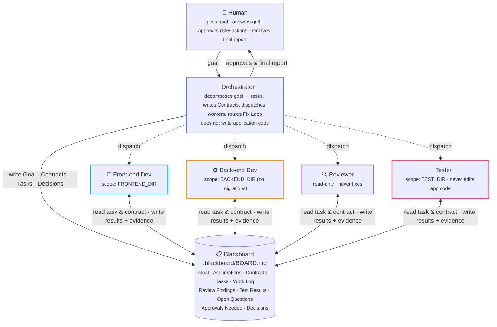
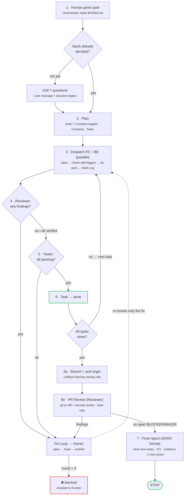
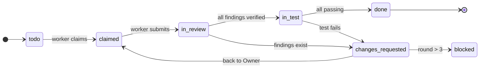
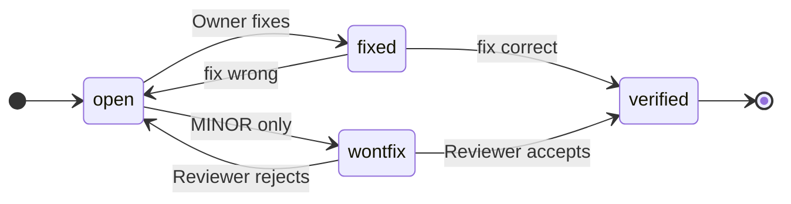

# my-agent

**Multi-agent orchestrator-worker setup for Claude Code that uses a blackboard as shared state.** One Orchestrator splits the work and four role agents carry it out: Front-end Developer, Back-end Developer, Reviewer, and Tester. Every agent reads and writes through a single file, `.blackboard/BOARD.md`. It is the only source of truth, so chat history is never relied on.

Built-in principles:
- **Karpathy guidelines:** think first, keep it simple, make targeted changes, work from verifiable goals.
- **Proof before "done":** every claim of done or passing must include the command and its output.
- **ADHD-friendly output:** the next action comes first, state is restated as `X/Y`, lists have at most 5 items, and every message ends with one concrete action.
- **Human approval** is required for risky actions such as deleting files, adding dependencies, changing schemas or migrations, or commit/push.

---

## Contents

| File | Purpose |
|---|---|
| [`AGENTS.md`](AGENTS.md) | Full spec: hard rules, skills, blackboard protocol, Review → Fix Loop, roles, stop conditions |
| [`CLAUDE.md`](CLAUDE.md) | Imports `AGENTS.md` so Claude Code loads it automatically |
| [`.blackboard/BOARD.md`](.blackboard/BOARD.md) | Empty blackboard template with the fixed sections |

---

## 1. Agent structure

### Skills per role

| Role | Always loaded | Only when a trigger matches |
|---|---|---|
| **Orchestrator** | `senior-fullstack` (grill + decision engine), ADHD output, Karpathy | — |
| **Front-end Dev** | `senior-fullstack`, ADHD output, Karpathy | `ui-ux-pro-max`, `refactor` |
| **Back-end Dev** | `senior-fullstack`, ADHD output, Karpathy | `sql-optimizer`, `refactor` |
| **Reviewer** | `senior-fullstack` (`code_quality_analyzer`), ADHD output, Karpathy | `security-review` (security-relevant diffs; always on the PR diff) |
| **Tester** | `senior-fullstack` (testing strategy), ADHD output, Karpathy | — |

Conditional skill triggers (whichever skill gets loaded, the agent must record the matching trigger in the Work Log):

- **`ui-ux-pro-max` (FE):** new page or component, changes to layout, style, typography, or color, forms, navigation, animation, charts, accessibility, or a UI/UX finding. Skipped for pure logic.
- **`sql-optimizer` (BE):** slow query or timeout, p95/p99 above target, a query on a large table or with JOIN + ORDER BY + LIMIT, or an N+1 pattern. `EXPLAIN ANALYZE` runs only on dev or a copy, never on production. A new index counts as a migration, so it needs approval.
- **`refactor` (FE/BE):** an explicit refactor task, or code that must be changed but is too tangled. Tests must pass first. No behavior changes, and no rendered-output changes for FE. No commits. If the refactor is bigger than the feature, it becomes a separate task.
- **`security-review` (Reviewer):** diffs touching auth or sessions, user input reaching SQL/shell/paths/templates, crypto or secrets, new endpoints that expose data, or HTML rendering. Always run on the PR diff. Only findings with confidence ≥ 8/10 are kept: HIGH becomes BLOCKER and MEDIUM becomes MAJOR. It never edits code.

---

## 2. Workflow

### Review → Fix Loop

Every finding goes back to **the worker who did the task**. The Reviewer and Tester **never** fix code themselves.

1. The Reviewer writes findings in the format `[R-T03-1][BLOCKER|MAJOR|MINOR][open] file:line — problem — fix — skill hint`.
2. The Orchestrator sets the task to `changes_requested` and dispatches it to the same role as the Owner, along with the finding IDs and the skill hint.
3. The Owner fixes each finding and marks it `[fixed]` with evidence, or `[wontfix]` with a reason. `wontfix` is allowed for MINOR only.
4. The Reviewer re-reviews **only the listed findings and the fix diff**. A new finding is only allowed if the fix introduced it.
5. Once everything is `[verified]`, the task goes to the Tester. A failing test follows the same loop with `[F-T03-n]` IDs.

### Branch & sync

- Work always happens on a feature branch (`<type>/<T-ID>-<slug>`), never on `main`. Creating the local branch needs no approval.
- Before every PR and re-push, the Orchestrator runs `git fetch origin` and `git pull origin main` into the branch. No rebase or force-push without your approval.
- A conflict goes to the role that owns the file: `FRONTEND_DIR` to Front-end, `BACKEND_DIR` to Back-end, `TEST_DIR` to Tester. Files outside any role go to you.
- The fixing role only touches the conflict hunks in its own files, keeps both sides' intent, and runs its tests. Then the Tester re-runs the tests and the Reviewer re-reviews only the resolution diff.
- `git reset --hard`, `git checkout -- <file>`, and `git push --force` are never used to make a conflict disappear.

### PR Review (after a PR is opened)

Once a PR exists, the Reviewer reads it with `gh pr diff` and **always** runs `security-review` on it.

- Findings go back to the Owner through the same loop. Fixes are pushed to the PR branch only after your approval.
- The Reviewer posts the result on the PR itself: one summary review plus an inline comment on the exact line of each finding. After a fix it posts a follow-up with the new status. It does not need your approval for this, and the comments contain no secrets and no AI attribution.
- The Reviewer only posts `COMMENT` reviews. It **never approves, requests changes, or merges** the PR. That stays with you.
- Maximum of 3 PR review rounds, then `blocked`.

Maximum of **3 rounds** per task (review + test combined). Round 4 sets the task to `blocked` and escalates it to the human.

---

## 3. Task and finding status

A worker may only change its own task's status in two ways: `todo → claimed` and `claimed → in_review`. Every other status change is made by the Orchestrator.

---

## 4. Guardrails

| Requires human approval | Stop conditions |
|---|---|
| 1. Deleting files | 1. Task reaches 3 rounds → `blocked` |
| 2. Adding or upgrading dependencies | 2. Command fails 3× with the same error → stop |
| 3. Schema, migrations, new indexes | 3. Goal, contract, or targets unclear → ask 1 question |
| 4. CI/infra/env, scaffolder, `--persist` | 4. A claim without evidence = not done |
| 5. `git commit` / `git push` (always from a feature branch, after pulling origin), open or merge a PR (the Reviewer's own review comments are the one exception; no `Co-Authored-By` or AI attribution) | 5. All done + evidence → report, **STOP** |

---

## Usage

1. Copy `AGENTS.md`, `CLAUDE.md`, and `.blackboard/BOARD.md` to the root of your project repo.
2. In `AGENTS.md`, replace the placeholders `[FRONTEND_DIR]`, `[BACKEND_DIR]`, `[TEST_DIR]`, `[TEST_CMD]`, `[FE_LINT_CMD]`, `[FE_TEST_CMD]`, `[FE_BUILD_CMD]`, `[BE_LINT_CMD]`, and `[BE_TEST_CMD]`.
3. Make sure these skills are installed in `~/.claude/skills/`: `senior-fullstack`, `ui-ux-pro-max`, `sql-optimizer`, `refactor`. Karpathy guidelines and the ADHD output style are already written into `AGENTS.md`.
4. Open Claude Code in the project, then give it a goal. For example: *"Act as the Orchestrator per AGENTS.md. Goal: add a login page with an email + password API."*

> ⚠️ This setup runs agents with real access to your filesystem and terminal. Before using it, check the scope of each role, the actions that require approval, and the stop conditions.
