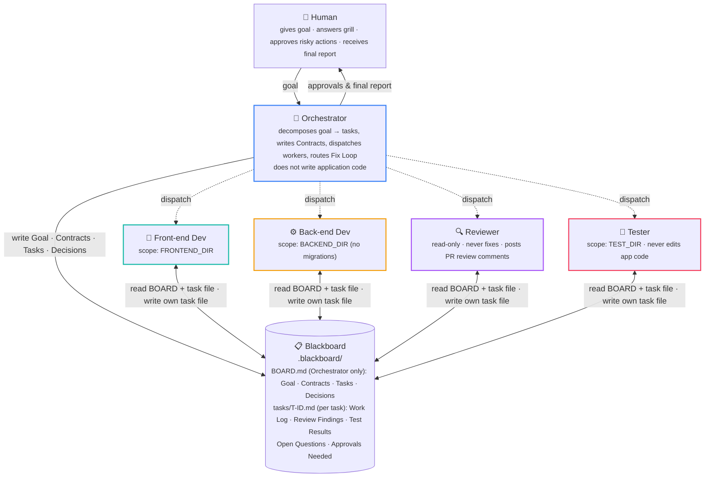
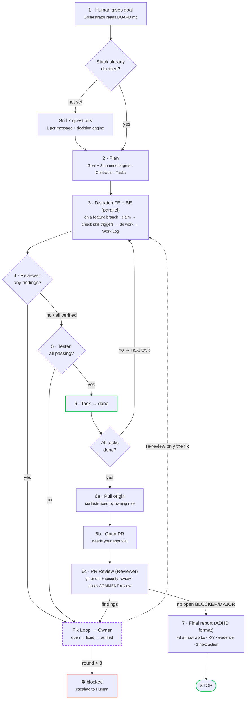
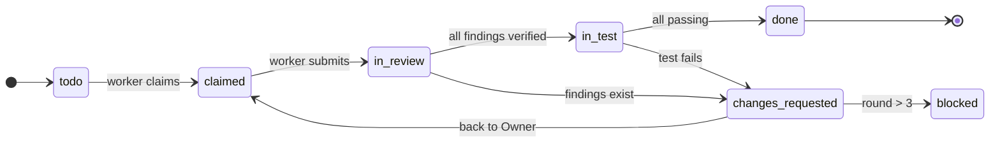
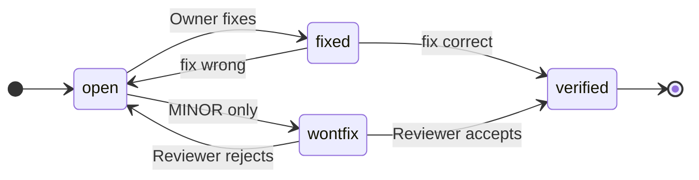

# my-agent

**Multi-agent orchestrator-worker setup for Claude Code that uses a blackboard as shared state.** One Orchestrator splits the work and four role agents carry it out: Front-end Developer, Back-end Developer, Reviewer, and Tester. Agents share state through the `.blackboard/` folder: the Orchestrator writes `BOARD.md`, and every task has its own file in `tasks/`. It is the only source of truth, so chat history is never relied on.

Built-in principles:
- **Karpathy guidelines:** think first, keep it simple, make targeted changes, work from verifiable goals.
- **Proof before "done":** every claim of done or passing must include the command and its output.
- **ADHD-friendly output:** the next action comes first, state is restated as `X/Y`, lists have at most 5 items, and every message ends with one concrete action.
- **Security and PR review:** the Reviewer runs `security-review` on risky diffs, always on the PR diff, and posts its findings on the PR as comments.
- **Branch discipline:** work happens on a feature branch, origin is pulled before every PR, and merge conflicts are fixed by the role that owns the files.
- **Human approval** is required for risky actions such as deleting files, adding dependencies, changing schemas or migrations, pushing, commits beyond the one-time per-task approval, or opening and merging a PR.

---

## Contents

| File | Purpose |
|---|---|
| [`AGENTS.md`](AGENTS.md) | Full spec: hard rules, skills, blackboard protocol, Review → Fix Loop, roles, stop conditions |
| [`CLAUDE.md`](CLAUDE.md) | Imports `AGENTS.md` so Claude Code loads it automatically |
| [`.blackboard/BOARD.template.md`](.blackboard/BOARD.template.md) | Template for the shared board (written only by the Orchestrator) |
| [`.blackboard/TASK.template.md`](.blackboard/TASK.template.md) | Template for one task file (Work Log, findings, test results) |
| [`.claude/agents/`](.claude/agents) | The five roles as Claude Code agents (tool limits, role instructions) |
| [`.claude/settings.json`](.claude/settings.json) | Registers the guard hook |
| [`.claude/hooks/guard.py`](.claude/hooks/guard.py) | Enforces scope, approvals, and no-attribution rules before each tool call |
| [`.claude/scope.json`](.claude/scope.json) | The only project-specific file: base branch, directories each role may write, test/lint/build commands |
| [`install.py`](install.py) | Installs or updates the team in another project without overwriting your files |
| [`.gitignore`](.gitignore) | Keeps the live board, task files, and archive out of git |

---

## 1. Agent structure

### Skills per role

| Role | Always loaded | Only when a trigger matches |
|---|---|---|
| **Orchestrator** | `senior-fullstack` (grill + decision engine), ADHD output, Karpathy | — |
| **Front-end Dev** | `senior-fullstack`, ADHD output, Karpathy | `ui-ux-pro-max`, `refactor` |
| **Back-end Dev** | `senior-fullstack`, ADHD output, Karpathy | `sql-optimizer`, `refactor` |
| **Reviewer** | `senior-fullstack` (`code_quality_analyzer`), ADHD output, Karpathy | `security-review` (security-relevant diffs; always on the PR diff) |
| **Tester** | `senior-fullstack` (testing strategy), ADHD output, Karpathy | — |

Conditional skill triggers (whichever skill gets loaded, the agent must record the matching trigger in the Work Log):

- **`ui-ux-pro-max` (FE):** new page or component, changes to layout, style, typography, or color, forms, navigation, animation, charts, accessibility, or a UI/UX finding. Skipped for pure logic.
- **`sql-optimizer` (BE):** slow query or timeout, p95/p99 above target, a query on a large table or with JOIN + ORDER BY + LIMIT, or an N+1 pattern. `EXPLAIN ANALYZE` runs only on dev or a copy, never on production. A new index counts as a migration, so it needs approval.
- **`refactor` (FE/BE):** an explicit refactor task, or code that must be changed but is too tangled. Tests must pass first. No behavior changes, and no rendered-output changes for FE. No commits. If the refactor is bigger than the feature, it becomes a separate task.
- **`security-review` (Reviewer):** diffs touching auth or sessions, user input reaching SQL/shell/paths/templates, crypto or secrets, new endpoints that expose data, or HTML rendering. Always run on the PR diff. Only findings with confidence ≥ 8/10 are kept: HIGH becomes BLOCKER and MEDIUM becomes MAJOR. It never edits code.

---

## 2. Workflow

### Review → Fix Loop

Every finding goes back to **the worker who did the task**. The Reviewer and Tester **never** fix code themselves.

1. The Reviewer writes findings in the format `[R-T03-1][BLOCKER|MAJOR|MINOR][open] file:line — problem — fix — skill hint`.
2. The Orchestrator sets the task to `changes_requested` and dispatches it to the same role as the Owner, along with the finding IDs and the skill hint.
3. The Owner fixes each finding and marks it `[fixed]` with evidence, or `[wontfix]` with a reason. `wontfix` is allowed for MINOR only.
4. The Reviewer re-reviews **only the listed findings and the fix diff**. A new finding is only allowed if the fix introduced it.
5. Once everything is `[verified]`, the task goes to the Tester. A failing test follows the same loop with `[F-T03-n]` IDs.

Maximum of **3 rounds** per task (review + test combined). Round 4 sets the task to `blocked` and escalates it to the human.

### Blackboard layout & commits per task

- `BOARD.md` has a single writer, the Orchestrator, so parallel agents never overwrite each other. Each task has its own file, `tasks/<T-ID>.md`, written only by the roles working that task. The Orchestrator mirrors statuses, questions, and approvals into `BOARD.md`.
- `BOARD.md`, `tasks/`, and `archive/` are git-ignored, so PRs contain only real changes. Only the two templates are committed. A new goal archives the old board first.
- You give a **one-time approval** for local commits on the feature branch. Each task is then one commit (`T-<ID>: <description>`), staged by path, and each fix is a new commit. The Reviewer reviews `git show <sha>` and re-reviews `git diff <prev>..<fix>`, so FE and BE diffs never mix. Pushing is never covered.

### Branch & sync

- Work always happens on a feature branch (`<type>/<T-ID>-<slug>`), never on the base branch (`base_branch` in `.claude/scope.json`, usually `main`). Creating the local branch needs no approval.
- Before every PR and re-push, the Orchestrator runs `git fetch origin` and `git pull origin <base_branch>` into the branch. No rebase or force-push without your approval.
- A conflict goes to the role that owns the file: `FRONTEND_DIR` to Front-end, `BACKEND_DIR` to Back-end, `TEST_DIR` to Tester. Files outside any role go to you.
- The fixing role only touches the conflict hunks in its own files, keeps both sides' intent, and runs its tests. Then the Tester re-runs the tests and the Reviewer re-reviews only the resolution diff.
- `git reset --hard`, `git checkout -- <file>`, and `git push --force` are never used to make a conflict disappear.

### PR Review (after a PR is opened)

Once a PR exists, the Reviewer reads it with `gh pr diff` and **always** runs `security-review` on it. PR findings use IDs like `[R-PR12-1]`.

- Findings go back to the Owner through the same loop. Fixes are pushed to the PR branch only after your approval.
- The Reviewer posts the result on the PR itself: one summary review plus an inline comment on the exact line of each finding. After a fix it posts a follow-up with the new status. It does not need your approval for this, and the comments contain no secrets and no AI attribution.
- The Reviewer only posts `COMMENT` reviews. It **never approves, requests changes, or merges** the PR. That stays with you.
- Maximum of 3 PR review rounds, then `blocked`.

---

## 3. Task and finding status

A worker may only change its own task's status in two ways: `todo → claimed` and `claimed → in_review`. Every other status change is made by the Orchestrator.

---

## 4. Guardrails

| Requires human approval | Stop conditions |
|---|---|
| 1. Deleting files | 1. Task reaches 3 rounds → `blocked` |
| 2. Adding or upgrading dependencies | 2. Command fails 3× with the same error → stop |
| 3. Schema, migrations, new indexes | 3. Goal, contract, or targets unclear → ask 1 question |
| 4. CI/infra/env, scaffolder, `--persist` | 4. A claim without evidence = not done |
| 5. `git push`, and `git commit` outside the one-time per-task approval (always from a feature branch, after pulling origin), open or merge a PR (the Reviewer's own review comments are the one exception; no `Co-Authored-By` or AI attribution) | 5. All done + evidence → report, **STOP** |

---

## 5. Enforcement

The rules in `AGENTS.md` are backed by agents and a hook, so they hold even when a model is tempted to skip them.

| Enforced by the hook | How |
|---|---|
| Role scope | Writes outside your directories, into another role's files, or to `.claude/`, `AGENTS.md`, `BOARD.md` are **denied**. |
| Orchestrator writes no app code | It may write only under `.blackboard/`. |
| Reviewer is read-only | It may write only its own task file. `git add/commit/checkout/reset`, `sed -i`, and redirects outside `.blackboard/tasks/` are denied. |
| Test files belong to the Tester | FE and BE are denied on `*.test.*`, `*.spec.*`, `__tests__/` and the test directories. The Tester may edit them anywhere. |
| No lost work | `git reset --hard`, `git checkout -- <file>`, `git clean`, `git add -A`/`.` are **denied**. |
| No AI attribution | `Co-Authored-By` or "Generated with" in a commit, PR, or comment is **denied**. |
| PR limits | Merging, approving, and requesting changes are denied. Only the Reviewer may post reviews and comments. |
| Needs you | Push, force-push, `gh pr create`, rebase/amend, deleting files, new dependencies, migrations, and CI/infra/env files **ask you first**. |

**Limits:**
- Bash checks are best-effort hardening, not a sandbox.
- The hook acts only when Claude Code reports the agent name (`agent_type`) as one of the five roles. Plain sessions are never touched. I could only test the hook with synthetic inputs, so run the guard check from "Use it in another project" once.
- Project hooks and agents need you to trust the folder the first time.

---

## Use it in another project

The team files are the same in every project. The only project-specific file is `.claude/scope.json`.

**Prepare once per machine**
1. `python3`, `git`, and the GitHub CLI (`gh`) installed.
2. `gh auth login` for every GitHub account you use. Before a project's first review, run `gh auth switch -u <account>` so the Reviewer comments as the right account.
3. These skills in `~/.claude/skills/`: `senior-fullstack`, `ui-ux-pro-max`, `sql-optimizer`, `refactor`. `security-review` comes with Claude Code. A missing skill is noted in Open Questions and skipped.
4. Check your global gitignore with `git check-ignore -v CLAUDE.md` inside a project. If it ignores `CLAUDE.md`, commit it with `git add -f CLAUDE.md`, or teammates will not get it.

**Prepare per project**
1. Run `python3 /path/to/my-agent/install.py /path/to/project` (add `--dry-run` first to see the plan). It copies the team files, merges `.gitignore`, `CLAUDE.md`, and the hook in `.claude/settings.json`, and never overwrites your files. A file that already exists and differs, such as your own `AGENTS.md`, is reported as `CONFLICT` and left alone.
2. Fill `.claude/scope.json`: `frontend_dirs`, `backend_dirs`, `test_dirs`, `migration_dirs`, and the `commands` (tests, lint, build). `base_branch` is detected. The installer lists directories it recognizes. Backend-only project: leave `frontend_dirs` empty. An unfilled scope blocks the workers.
3. Commit the new files on a feature branch, including `.claude/team-install.json`, and open a PR as usual.
4. Start `claude --agent orchestrator` in the project and trust the folder when asked.
5. Check the guard once: ask the Reviewer agent to create a file under your backend directory. It must be blocked. If it is not, the agent name differs from the five role names, so check `agent_type` in the hook input.
6. Give it a goal. For example: *"Goal: add a login page with an email + password API."*

**Update later:** `git pull` in this repo, then `python3 install.py /path/to/project --update`. It overwrites only files you have not changed. A file you edited is reported as `CONFLICT` and left alone. `scope.json` is never touched.

> ⚠️ This setup runs agents with real access to your filesystem and terminal. Before using it, check the scope of each role, the actions that require approval, and the stop conditions.
